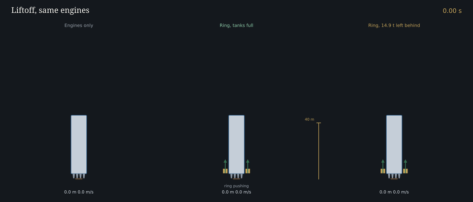
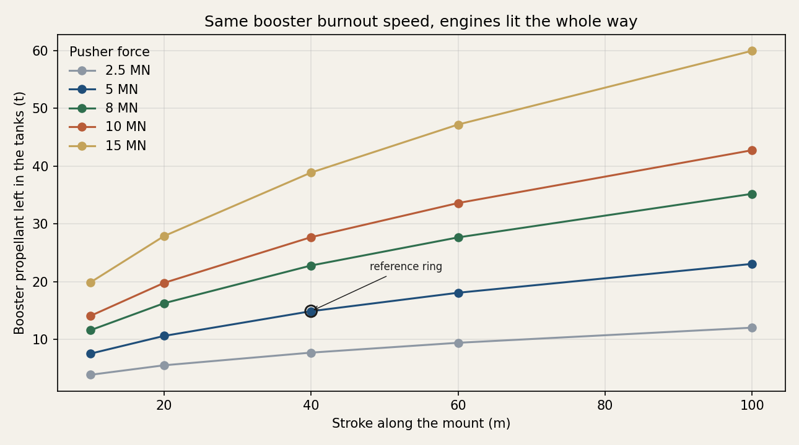
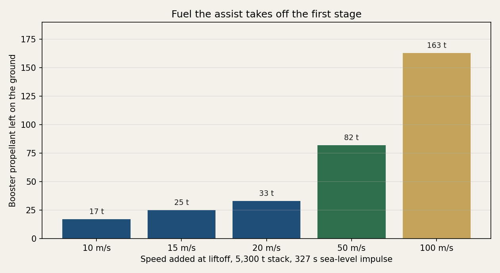
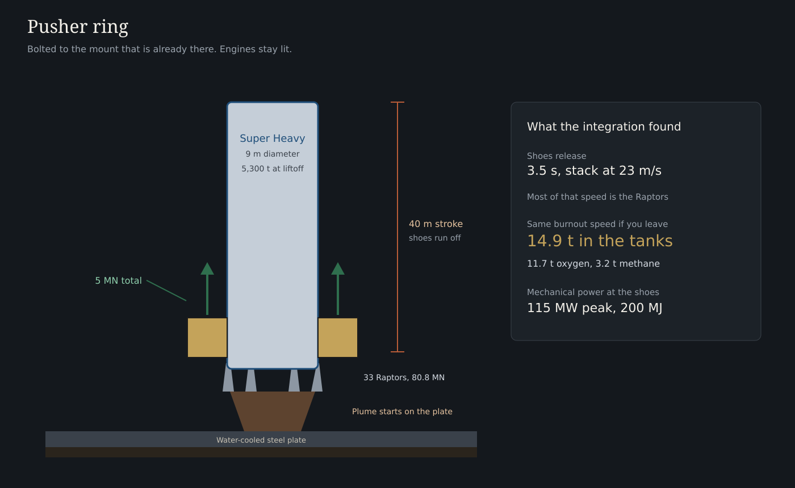
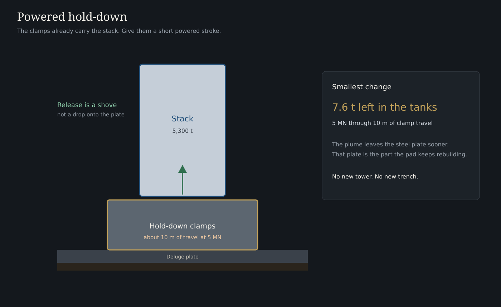
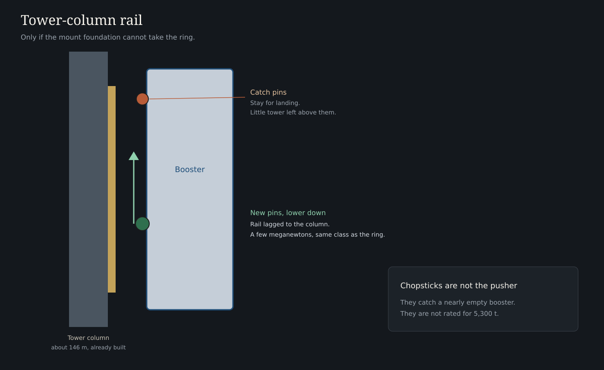

# Starship electromagnetic launch assist

A retrofit on the Starbase mount. The bore, or in this case a short pusher, supplies the first few meters per second. Super Heavy still does the ascent. The point is methalox left in the farm tanks, not a gun that replaces the rocket.

Starship's tank wall is 304L stainless, which will not serve as an armature. The shoes are bolted on. The chopsticks stay a catching tool. They are built for a nearly empty booster, not a 5,300 t liftoff.

## Vehicle and pad

Block 3 public figures. Where two numbers are in circulation, both are listed.

| Item | Figure |
| --- | --- |
| Stack | 124.4 m, 9 m diameter, about 5,000 to 5,300 t fully fueled |
| Super Heavy | 72.3 m, about 3,650 t propellant |
| Propellant split | about 2,860 t liquid oxygen, 790 t liquid methane, mixture ratio about 3.6 |
| Booster engines | 33 Raptor 3, liftoff thrust 80.8 MN |
| Liftoff thrust-to-weight | about 1.55 |
| Ship | about 52 m, about 1,600 t propellant, 3 sea-level and 3 vacuum Raptors |
| Raptor 3, flight rating | 250 tf sea level, about 275 tf vacuum |
| Raptor 3, stand post (Aug 2024) | 280 tf, 1,525 kg, 350 bar, 350 s |
| Chamber pressure | up to 330 bar in operation, 350 bar design |
| Cycle | full-flow staged combustion, methane and oxygen, subcooled |
| Tower | about 146 m, chopsticks at the grid-fin catch pins |
| Mount | orbital launch mount over a water-cooled steel plate, hold-down clamps, no flame trench |

Booster dry mass of 275 t is the published Block 1 number. Block 3 dry mass is not published.

## Simulated liftoff

The engines are at 80.8 MN before the clamps let go. The pusher adds force on top of that, straight up, until the shoes run off the end of the stroke. Pitch follows altitude, the same schedule with and without the pusher, so the turn is not doing the work. The comparison is booster burnout speed. Propellant left in the tanks is the largest offload that still matches the unassisted burnout speed.

The reference ring is 5 MN and 40 m. The shoes let go at 3.6 s. The stack is then at 24 m/s, and most of that speed is the Raptors. With the tanks full, burnout speed is 4.7 m/s higher. Leave 14.9 t in the farm and the burnout speed matches: 11.7 t of oxygen and 3.2 t of methane.

The first five seconds, from the same liftoff integration. Left side is engines only. Right side is the same engines plus the ring. The gap opens while the shoes are on the motors, then both keep climbing after the shoes run off.

| Force | 20 m stroke | 40 m stroke | 60 m stroke | 100 m stroke |
| --- | ---: | ---: | ---: | ---: |
| 2.5 MN | 5.6 t | 7.8 t | 9.5 t | 12.1 t |
| 5 MN | 10.6 t | 14.9 t | 18.1 t | 23.1 t |
| 8 MN | 16.3 t | 22.8 t | 27.7 t | 35.2 t |
| 10 MN | 19.8 t | 27.7 t | 33.6 t | 42.7 t |
| 15 MN | 27.9 t | 38.9 t | 47.2 t | 59.9 t |

Fifteen meganewtons through a shoe is three Raptors standing on a fitting. That row is the edge of what the skirt can even be asked to do. The 5 MN ring is the case that fits the mount.

A rocket-equation estimate that only subtracts an exit speed from the whole stack, and ignores that the engines are already lit, is larger than this. It is plotted below so the two claims stay apart. The liftoff integration is the one used for the retrofit.

| Added speed | Propellant not loaded |
| --- | ---: |
| 10 m/s | 17 t |
| 15 m/s | 25 t |
| 20 m/s | 33 t |
| 50 m/s | 82 t |
| 100 m/s | 163 t |

About 78 percent of that is oxygen and 22 percent is methane. A retrofit cannot honestly buy the 50 and 100 m/s rows. The stroke on this pad is tens of meters, and the skirt cannot take a local load comparable to the whole engine bay. Those rows are the reason a new track would be a new launch structure.

## Three retrofits

**Pusher ring.** A truss on the existing mount foundation, outside the engine bells. Linear motors push bolted shoes on the aft skirt for 40 m, then the shoes run off. Engines are already at full thrust. The flame stays on the steel plate. Five meganewtons. The integration leaves 14.9 t of methalox in the tanks at the same booster burnout speed. Peak power is about 43 MW for under a second.

**Hold-down stroke.** The clamps already carry the fueled stack. Give them about 10 m of powered travel. At 5 MN that leaves 7.6 t in the tanks. The plume also spends less time on the deluge plate.

**Tower-column rail.** A second pin set lower on the booster, in a rail lagged to the tower columns. The grid-fin pins are too high. Little tower remains above them. The column load is the same few-meganewton class as the ring. Use this only if the mount foundation cannot take the ring.

Electricity is a capacitor yard beside the pad. Starbase already runs an air separation plant. The structure is the constraint, not the energy.

## Out of scope

A ground track to hundreds of meters per second. The fuel save is real there, and the stroke at a force this vehicle can take is a new facility.

Redraw the figures with `python src/figures.py`.

## License

MIT. Copyright 2026 Nicholas Dean Perry.
