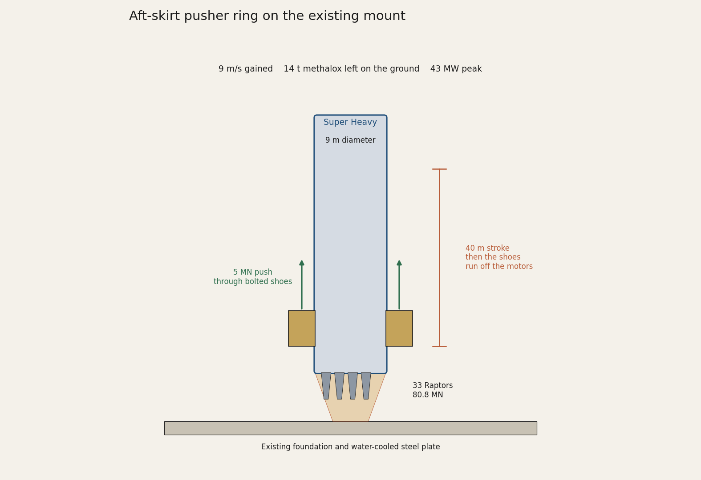
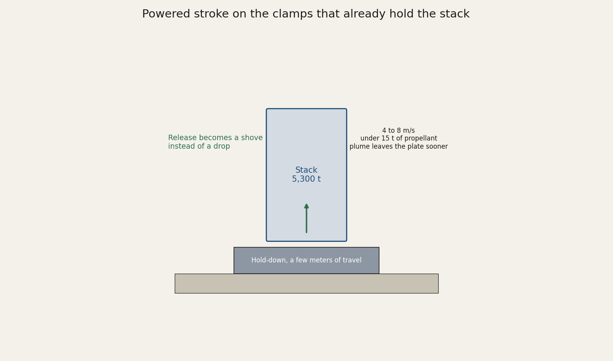
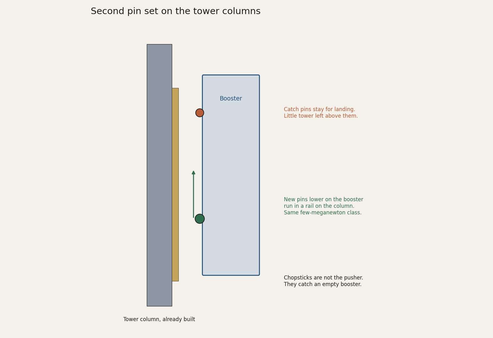

# Starship electromagnetic launch assist

A retrofit on the Starbase mount. The bore, or in this case a short pusher, supplies the first few meters per second. Super Heavy still does the ascent. The point is methalox left in the farm tanks, not a gun that replaces the rocket.

Starship's tank wall is 304L stainless, which will not serve as an armature. The shoes are bolted on. The chopsticks stay a catching tool. They are built for a nearly empty booster, not a 5,300 t liftoff.

## Vehicle and pad

Block 3 public figures. Where two numbers are in circulation, both are listed.

| Item | Figure |
| --- | --- |
| Stack | 124.4 m, 9 m diameter, about 5,000 to 5,300 t fully fueled |
| Super Heavy | 72.3 m, about 3,650 t propellant |
| Propellant split | about 2,860 t liquid oxygen, 790 t liquid methane, mixture ratio about 3.6 |
| Booster engines | 33 Raptor 3, liftoff thrust 80.8 MN |
| Liftoff thrust-to-weight | about 1.55 |
| Ship | about 52 m, about 1,600 t propellant, 3 sea-level and 3 vacuum Raptors |
| Raptor 3, flight rating | 250 tf sea level, about 275 tf vacuum |
| Raptor 3, stand post (Aug 2024) | 280 tf, 1,525 kg, 350 bar, 350 s |
| Chamber pressure | up to 330 bar in operation, 350 bar design |
| Cycle | full-flow staged combustion, methane and oxygen, subcooled |
| Tower | about 146 m, chopsticks at the grid-fin catch pins |
| Mount | orbital launch mount over a water-cooled steel plate, hold-down clamps, no flame trench |

Booster dry mass of 275 t is the published Block 1 number. Block 3 dry mass is not published.

## What the shove is worth

Sea-level exhaust velocity is about 3,210 m/s (327 s). On a 5,300 t stack, speed added at liftoff comes off the booster propellant load.

| Added speed | Propellant not loaded |
| --- | ---: |
| 10 m/s | 17 t |
| 15 m/s | 25 t |
| 20 m/s | 33 t |
| 50 m/s | 82 t |
| 100 m/s | 163 t |

About 78 percent of that is oxygen and 22 percent is methane. A retrofit cannot honestly buy the 50 and 100 m/s rows. The stroke on this pad is tens of meters, and the skirt cannot take a local load comparable to the whole engine bay. Those rows are the reason a new track would be a new launch structure.

## Three retrofits

**Pusher ring.** A truss on the existing mount foundation, outside the engine bells. Linear motors push bolted shoes on the aft skirt for about 40 m, then the shoes run off. Engines are already at full thrust. The flame stays on the steel plate. Five meganewtons, about 9 m/s, about 14 t of methalox, peak power about 43 MW for under a second.

**Hold-down stroke.** The clamps already carry the fueled stack. Give them a few meters of powered travel so release is a shove. Four to eight meters per second, under 15 t of propellant. The plume also spends less time on the deluge plate.

**Tower-column rail.** A second pin set lower on the booster, in a rail lagged to the tower columns. The grid-fin pins are too high. Little tower remains above them. The column load is the same few-meganewton class as the ring. Use this only if the mount foundation cannot take the ring.

Electricity is a capacitor yard beside the pad. Starbase already runs an air separation plant. The structure is the constraint, not the energy.

## Out of scope

A ground track to hundreds of meters per second. The fuel save is real there, and the stroke at a force this vehicle can take is a new facility.

Redraw the figures with `python src/figures.py`.

## License

MIT. Copyright 2026 Nicholas Dean Perry.
