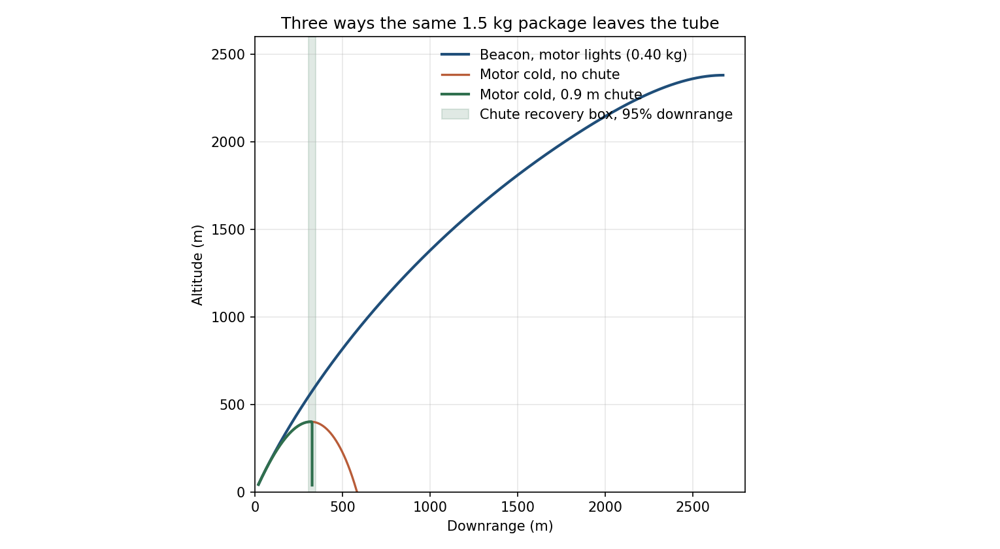
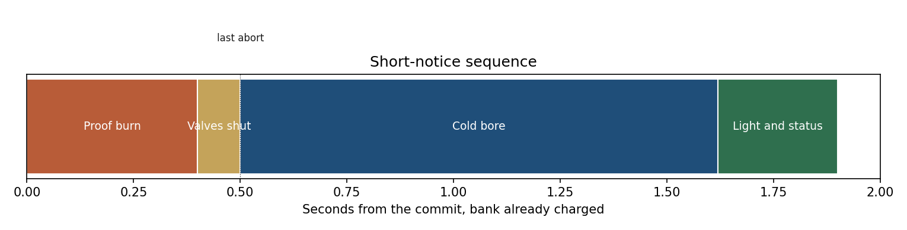
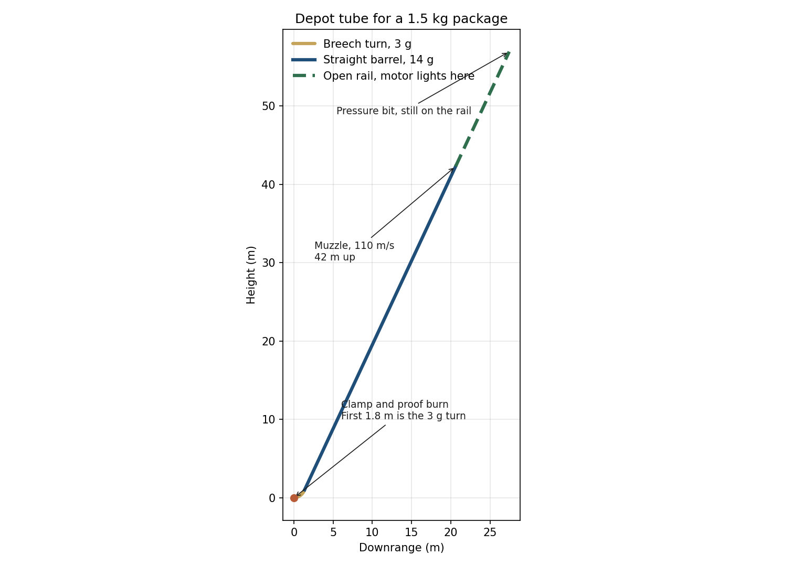
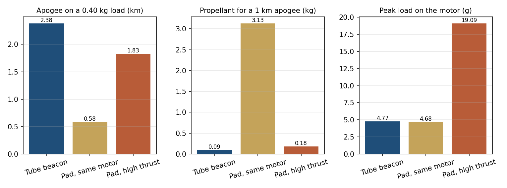
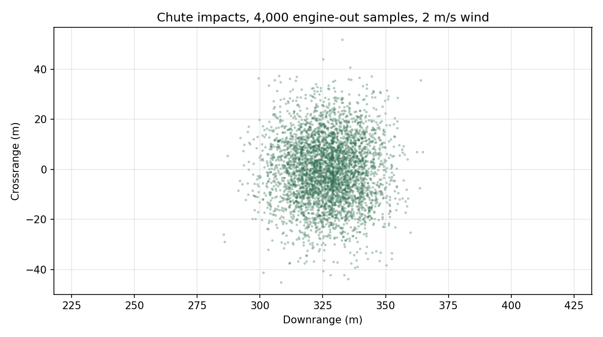
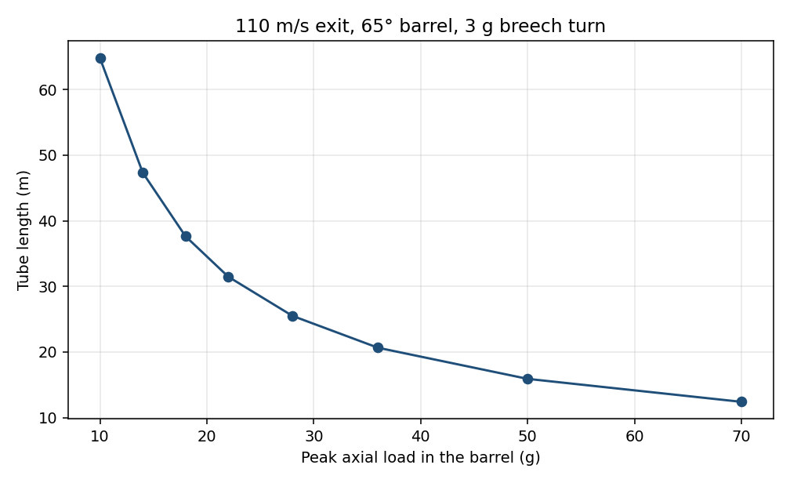
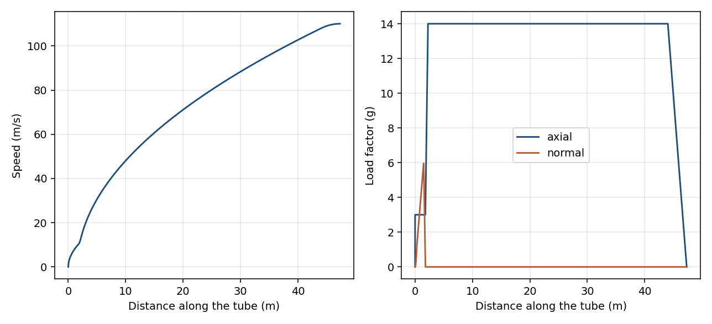
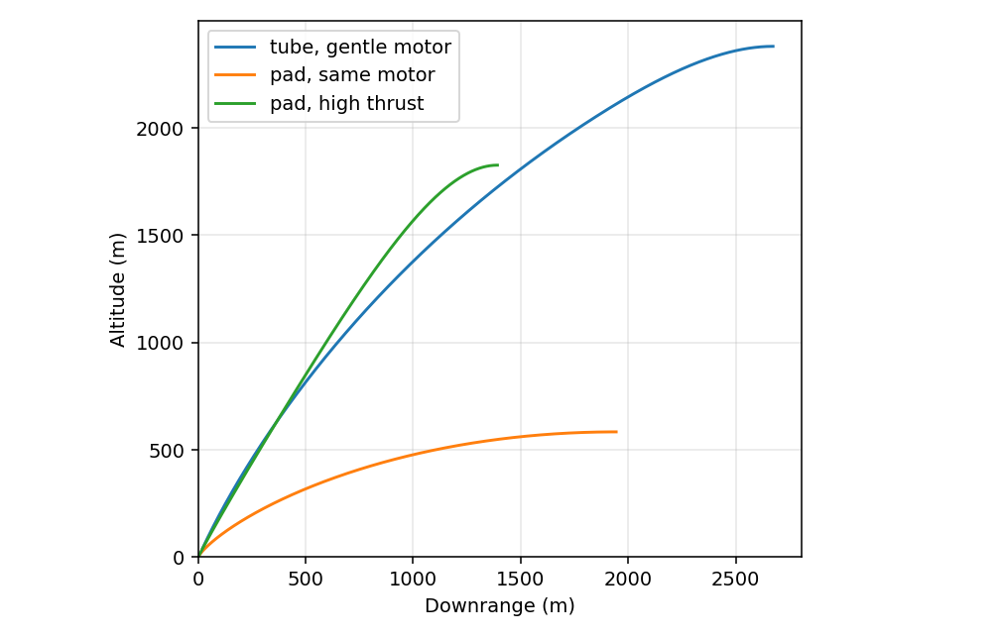

# em-ascent

A depot tube for a small package on short notice. The craft is 1.50 kg wet and 70 mm across, already sitting on the breech clamp. The bank for one shot is about 49 kJ. From the commit, the proof burn is 0.4 s and the bore run is 1.1 s.

Three jobs, same tube:

1. **Beacon.** Radio relay, marker, or camera lofted on a 51 N motor. With 0.40 kg of propellant the apogee is 2.38 km. A 1 km apogee needs 0.093 kg.
2. **Quick look.** Motor stays cold. The package coasts to about 400 m. Useful when the proof burn fails the flight light and a local sensor pass is still worth taking.
3. **Bring it back.** If the motor stays cold, a 0.9 m chute opens at apogee. Impact is about 5 m/s, inside a box roughly 310 to 350 m downrange and 26 m to either side.







The last abort is the end of the proof burn. After that the bore is cold, the motor lights on the open rail, and a dead motor selects the chute. It does not stop a craft that is already at 110 m/s.





## Length and curvature

Peak axial load and tube length are the same decision. For this 110 m/s, 65° exit:

| Barrel load | Tube length | Muzzle height | Peak electrical power |
| --- | ---: | ---: | ---: |
| 10 g | 64.8 m | 58.1 m | 88 kW |
| 14 g | 47.3 m | 42.3 m | 119 kW |
| 18 g | 37.6 m | 33.5 m | 150 kW |
| 28 g | 25.5 m | 22.5 m | 226 kW |
| 50 g | 15.9 m | 13.8 m | 385 kW |
| 70 g | 12.4 m | 10.6 m | 521 kW |

Stored electrical energy stays near 49 kJ across that table, at 20% coil efficiency. A longer tube lowers the peak power and the peak g. It does not save much energy. The kinetic energy is set by the exit speed.

The reference pick is the 14 g row. It is the mildest barrel that still finishes inside 50 m. Fourteen g for about one second is a hard push for a small airframe, and it is less than the 19 g burnout load of the high-thrust pad motor below.

Curvature belongs at the breech, while the craft is still slow. The reference turn is a clothoid into a 1.5 m radius arc and a clothoid back to straight. Turn acceleration is 3 g. Peak side load is 6.0 g, at about 10 m/s. Side load on a circular turn run at constant acceleration from rest is `2 * a * Δθ`, so the radius does not set that ratio. A bigger radius spends more tube and finishes the turn faster, which is worse for the balls. A waterslide that keeps curving out to the muzzle would put the side load on the fast end. At 110 m/s the same 57° turn needs a radius of tens of meters or the balls get crushed.





## Ball transfers

The coils push the craft. The balls only keep the sleeve off the wall.

Put the balls in the tube, pointing inward, as ball transfers. A spring plunger with a fixed ball tip would skid. The ball has to be free to spin. Use silicon nitride. A steel ball in the coil bore becomes part of the magnet.

The reference liner is rings of 8 balls on a 120 mm pitch. The sleeve is 300 mm long, so nine balls on the outer wall share the turn load. Peak load is 17 N per ball. The spring rate that reaches that load at 0.8 mm of travel is 21 kN/m. Preload is 6 N.

The craft carries short rub pads, 25 mm long. A straight 300 mm sleeve in a 1.5 m radius bore would rise 7.5 mm off the wall at mid-span and jam. A 25 mm pad rises 0.05 mm, inside the spring travel.

Hertz pressure at 17 N on an 8 mm ball:

| Rub surface | Peak pressure |
| --- | ---: |
| Hard nonmagnetic race | 1.53 GPa |
| Aluminum | 0.93 GPa |
| PEEK | 0.15 GPa |

Aluminum is at the edge of brinelling, so the pressure case should not be the running surface. PEEK is soft enough to live, and it will wear. A hard nonmagnetic strip is the reusable answer. The straight barrel is the easy part for the balls: at 65° the wall only holds a component of the weight, about 6 N total, while the coils take the 220 N axial load.

## When the motor lights

The abort happens at the breech, before the barrel coils are released. The craft is clamped. Valves open into a flame bucket behind the nozzle, and the motor burns for 0.4 s. Chamber pressure and the clamp load are the go/no-go. If they are not in family by 0.5 s, the valves close and the coils stay off. The vehicle has not moved. That is the least-damage abort.

The bore crossing is cold. A jet in the coil section cooks the ball transfers and the windings. A timer set for a 50 ms nominal delay does not prevent that. On a million draws with a 15 ms scatter, 44% of those timers light while the nozzle is still inside the bore. The early tail lights about 2.5 m inside.

A position interlock fixes the early tail. The fire line goes live only when the nozzle is 0.25 m past the closed-bore mouth, out on the open rail. The delay clock starts there.

| Igniter | Thrust starts | Chamber-pressure bit |
| --- | ---: | ---: |
| Fast, 20 ms | 2.5 m past the mouth | 6.9 m |
| Nominal, 50 ms | 5.8 m | 10.2 m |
| Slow, 100 ms | 11.3 m | 15.7 m |

The open rail runs to 16.2 m so the slow igniter still reports pressure while the sleeve is captured. That bit chooses powered flight or the chute. It does not stop a craft that is already at 110 m/s. Stopping from 110 m/s at 15 g takes 41 m.

The jet points back at the coil mouth. On a fast igniter the nozzle is 2.5 m out, and a 20° plume is about 0.9 m in radius by the time it reaches the mouth. The mouth gets a replaceable deflector. The guide rails sit beside the sleeve, ahead of the nozzle, outside that aft jet.

Lighting at 5.8 m instead of 0.5 m changes the reference apogee by about 9 m.

## If there is no motor

A fully magnetic flight uses the same breech gate, with bank voltage and the position encoders instead of chamber pressure. This 14 g tube at 110 m/s reaches a ballistic apogee of about 400 m. A straight 65° bore at 14 g needs 215 m/s at the muzzle to ballistic-coast to 1 km. That bore is 169 m long and the muzzle is 153 m up. The craft still arrives near 100 m/s if nothing slows it.

Engine-out from the reference muzzle, one million samples on the V100, wind 2 m/s:

| Recovery | Impact speed | Downrange | Crossrange, 95% |
| --- | ---: | ---: | ---: |
| None | 79 m/s | 549 to 617 m | 47 m |
| 0.9 m chute, opened at apogee | 5.1 m/s | 308 to 346 m | 26 m |

The chute impact is about 19 J. The bare impact is about 4.6 kJ. A magnetic catch of the 79 m/s impact, at 15 g, is still a 21 m brake that has to be placed in that ellipse. The chute is the small-craft way to land with little damage. A magnetic brake is the tool for an abort that is still on a rail, not for a craft falling from 400 m.

## What the motor still has to do

Same craft. Isp 205 s. Cd 0.50. The gentle motor is T/W 3.5 at ignition, 51 N. The pad cases ride a 2 m rail at 65° so a slow gravity turn does not immediately bend them into the ground. The tube craft lights on the open rail, 5.8 m past the closed bore, which is the nominal delay after the position interlock.

| Mission | Thrust | Peak motor load | Apogee on 0.40 kg | Propellant for a 1 km apogee | Peak dynamic pressure |
| --- | ---: | ---: | ---: | ---: | ---: |
| Tube, then the gentle motor | 51 N | 4.8 g | 2380 m | 0.093 kg | 22 kPa |
| Pad rail, same gentle motor | 51 N | 4.7 g | 584 m | 3.13 kg | 25 kPa |
| Pad rail, high-thrust motor | 206 N | 19 g | 1826 m | 0.18 kg | 79 kPa |

The tube motor sees about 5 g. The high-thrust pad motor sees 19 g, four times the thrust, and a harsher max-q. The gentle motor on a pad can climb, and it needs about 3.1 kg of propellant to reach the same 1 km the tube reaches with 0.09 kg.



## What is modeled

The tube integration commands the craft acceleration and solves the axial force the coils have to supply, including gravity, rolling friction, and a 5% residual radial coil load. Work along the bore matches kinetic energy, potential energy, and friction work. That check is in `tests/test_tube.py`.

Coil shape, current, timing, and suck-back are not modeled. `data/reference_tube_profile.csv` is the force the coils have to produce. Capacitor mass is not in the craft mass. The motor is a point mass with constant thrust along the velocity vector after the rail or the muzzle.

The geometry map is 11,200 independent shots. On this machine that ran in 5.0 s on 86 processes. The engine-out cloud, one million samples, ran on the V100 in the cu124 PyTorch build because CuPy's CUDA 13 JIT does not build reductions for that GPU.

## Run

```bash
PYTHONPATH=src python -m pytest
PYTHONPATH=src python -m em_ascent.sweep
PYTHONPATH=src python -m em_ascent.report
PYTHONPATH=src python -m em_ascent.present
```

`sweep` rewrites `data/geometry_map.csv` and `data/reference_choice.json`. `report` rewrites the profile, the flight table, and the performance plots. `present` rewrites the depot, sequence, comparison, path, and recovery figures.

## License

MIT. Copyright 2026 Nicholas Dean Perry.
